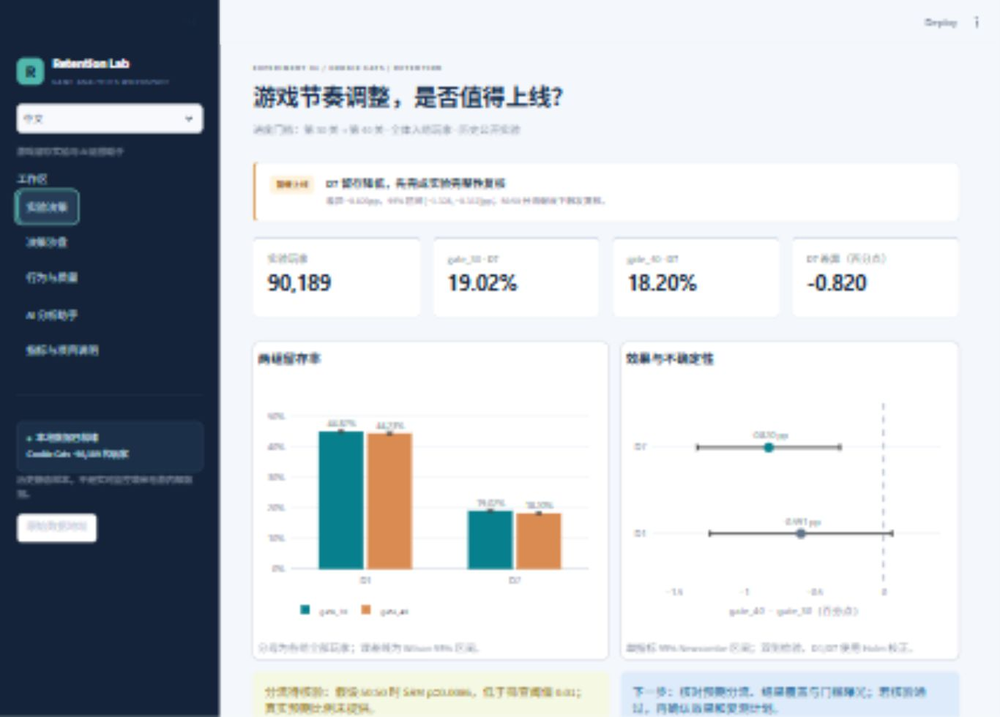

# 游戏留存实验分析与 AI 运营助手

**Game Retention Experiment Analytics & AI Operations Copilot**

基于 Cookie Cats 公开玩家实验数据的个人作品，回答一个具体运营决策：**把游戏进度门槛从第 30 关后移至第 40 关，是否值得上线？**

本项目以游戏留存实验为案例，面向产品决策与运营分析场景，使用 SQL、Python、统计检验和可追溯的 AI 工具调用连接“数据可信度 → 实验效果 → 运营动作 → 分析报告”。开发使用 AI 编程辅助；数据源、分析假设和实现边界均保留供复核。

**首次浏览从这里开始：** [作品介绍与使用说明](docs/project_guide_zh.md) · [English overview](docs/project_guide_en.md) · [交付方式说明](docs/HR_delivery.md)。交互版默认进入“作品导览”；不需要先读代码。

`setup.ps1` 会生成 `output/马延青_游戏分析项目介绍.pdf` 和 `output/HR_review_pack.zip`，供外部直接阅读，无需 Python 或密钥。访客网页源码位于 `web/`，通过 GitHub Pages 发布；完整 Python 版仍可在本地复现。

**[打开免登录访客版](https://jackzmyq.github.io/game-retention-copilot/)** · [完整源码](https://github.com/jackzmyq/game-retention-copilot)

访客版支持中英文分析、交互沙盘、报告下载和离线规则助手，不需要账号或 Key。SQL 面板展示 Python 构建时已执行的查询与结果，不执行任意 SQL；离线规则不会调用模型。完整 Python 版另含只读查询工具与可选 DeepSeek 接口，真实模型调用尚待验收。部署与复现见 [DEPLOYMENT.md](docs/DEPLOYMENT.md)。

## 结论先行

| 指标 | gate_30 | gate_40 | 实验组 − 对照组 |
|---|---:|---:|---:|
| 玩家数 | 44,700 | 45,489 | — |
| D1 留存 | 44.82% | 44.23% | −0.591 个百分点 |
| D7 留存 | 19.02% | 18.20% | **−0.820 个百分点** |

D7 差异的单指标 95% Newcombe 区间为 **[−1.328, −0.312] 个百分点**；双侧比例检验 p=0.00155；D1/D7 两项 Holm 校正后 p=0.00311。相对变化为 −4.31%，不是下降 4.31 个百分点。

**建议暂缓全量上线，先核验分流。** 假设 50:50 分流时，SRM 检查 p=0.00861，低于本项目筛查阈值 0.01。源数据未提供预期分流概率，因此这是条件性复核信号，不是已确认的随机化故障，也不能直接把观察差异解释成无条件因果效果。

## 快速运行

锁定依赖需要 Python 3.12+，当前在 Windows / Python 3.12 验证。

```powershell
cd game-retention-copilot
.\setup.ps1
.\start.ps1
```

浏览器访问 **http://127.0.0.1:8501**。若环境已准备好，直接运行 `start.ps1`。脚本只在项目目录内创建环境、下载数据、生成派生数据库与报告；不会修改全局 Python。

通用命令：

```bash
python -m venv .venv
# Activate the environment, then:
python -m pip install -r requirements-lock.txt
python scripts/download_data.py
python scripts/build_pipeline.py
python -m src.reporting
python -m streamlit run app.py
python -m pytest -q
```

`requirements-lock.txt` 是本次验证的版本快照；`requirements.txt` 提供依赖范围。公开网站若停止提供文件，下载会报错，不会自动换用模拟数据。

## 工作区

首次进入为 **作品导览**：项目用途、分析能力、三分钟路线、适用范围和完成状态，并可直接跳转到各工作区。

1. **实验决策**：D1/D7 分子分母、Wilson 留存区间、Newcombe 差异区间、Holm 校正与分流复核。
2. **决策沙盘**：假设规模下的人数影响与区间、可接受损害边界、分流假设敏感性，以及新实验样本量曲线。所有情景标注假设，不冒充已实现的业务损失或正式非劣效检验。
3. **行为与质量**：累计局数分布、与 D7 的描述性关联、极端值敏感性、质量检查、D1/D7 四种返回组合；行为筛选与导出保持一致，主实验始终保留全部玩家。
4. **AI 分析助手**：原生聊天界面、按模式与语言隔离的会话、DeepSeek function calling、聚合 SQL、指标知识检索、中英文报告及每条回答独立的执行证据；另有明确标注的无密钥离线规则演示。
5. **指标与项目说明**：指标字典、数据能力边界、来源 SHA-256、国际化迁移方案。



## AI 接入

最简单的方式：在页面选择 **DeepSeek 实时 Agent**，在隐藏输入框输入 API Key。密钥仅在当前页面会话使用，不写入文件。

也可运行：

```powershell
.\configure_api.ps1
```

它使用隐藏输入，将密钥写入本地 `.env`；文件已加入 `.gitignore`。**不要在聊天、截图或 Git 中公开密钥。** 默认模型 `deepseek-flash`，以 [DeepSeek 官方调用说明](https://api-docs.deepseek.com/) 为准；可在页面修改模型。

真实 Agent 的执行路径：

```text
问题 → LLM 选择工具 → 读取字典/统计/SQL → 返回聚合证据 → LLM 解释 → 人工复核
```

工具包括 `get_schema`、`get_metric_knowledge`、`query_metrics`、`get_experiment_evidence`、`get_decision_report`、`evaluate_decision_scenario`。最多 6 轮模型调用、12 次工具调用。实时模式带入最多六条最近对话，并要求重新检索证据，不能用历史回答代替本次查询。模型可以在工具报错后修正查询；仅查 schema 或没有成功检索证据时，不展示最终回答。

- SQL 经 AST 校验，仅开放 7 个聚合视图；SQLite 只读、query_only、authorizer、函数白名单、200 行限制和 3 秒查询超时共同约束执行。
- 单值/单行大小另设约 1 MB 上限，并限制列数、表达式深度；不开放可能生成巨量格式化字符串的 printf/format 函数。调用方不能把行数或超时改为无限制。
- 查询工具没有玩家 ID、凭据、原始文件读取或写库权限。LLM 仅接收问题、指标定义和聚合证据；不发送原始玩家记录。
- 真实模型回答仍可能解读错误；轨迹用于人工审阅，不代表已消除幻觉。
- 本地 `reports/agent_runs/` 保存问题、回答、用量与聚合轨迹，不保存密钥；此目录不提交 Git。
- 回答记录证据构建 ID。若本次多轮工具调用期间数据库被重建，系统拒绝交付该回答；历史消息若来自先前构建，会显示提示。
- 知识库是通过函数读取的 Markdown 文档。**不声称实现向量 RAG、MCP、生产级实时监控或自动干预。**

在配置密钥前，已完成的验证是工具协议模拟、真实本地 SQL、统计和 UI 测试；不应将此写成“已通过真实 DeepSeek 端到端验收”。参见 [验收记录](docs/verification.md)。

**API 是可选增强。** 数据分析、决策沙盘、图表、SQL 工作台和双语简报均可离线运行。离线规则只展示固定意图，不声称通用多轮理解；要演示真实 LLM 自主选工具才需要启用模型连接。本轮参考了 GitHub 的实验决策与聊天助手案例，改动和边界见 [GitHub 参考记录](docs/github_references.md)。

## 数据来源与定义

- [DataCamp 原始 CSV](https://assets.datacamp.com/production/project_184/datasets/cookie_cats.csv)：90,189 名玩家、5 个字段，发布者提供的历史教学 A/B 实验。
- [教学 notebook 镜像](https://github.com/DataCamp-Data-Science-Projects/Project-Mobile-Games-AB-Testing-with-Cookie-Cats)：记录了随机分组与字段语义；是同一上游材料，不是独立来源验证。
- 原始 SHA-256：`5ab54d761fbddcd50de7b88e4eaf7837cba4569474f50c043a4d17ee342c46bd`。
- 下载与构建均校验该已审核指纹，缓存文件也不例外。文件发生变化时停止处理，不会用新指纹覆盖基线；需恢复原始文件或明确审核新版本。
- 尚未核验明确的原始数据再分发许可，故原始 CSV、教学材料和派生 SQLite 不随代码仓库发布。下载脚本从发布者地址获取，来源清单保存在本地 `data/raw/manifest.json`。

`retention_1` / `retention_7` 分别为安装后第 1 / 7 天是否返回的源标记，全体入组玩家为分母。它们不是累计留存，也不是顺序漏斗；当前没有逐条时间戳来重新核验日界、观察期成熟度或标签生成。

`sum_gamerounds` 在教学材料字段列表中写“前 14 天”，后文写“首周”，存在冲突。本项目统一称为**记录期累计局数**，不核定为 7 天特征，不把局数等同关卡数或门槛曝光，不用它预测 D7。

## 重建与失败保护

数据库先在项目内的临时目录构建、校验并关闭连接，再替换已有文件；计算中途失败会保留旧数据库和旧报告。数据库和分析 JSON 共用构建 ID，页面加载时检查一致性，发现发布中断或版本不匹配会停止展示。数据库及多份报告不是一个跨文件事务，不能宣称整套目录全局原子切换；版本检查用于拒绝混用。

`python -m src.reporting` 会统一生成中英文决策简报、默认决策情景及两份离线证据示例，每个文件先写入暂存文件再替换。用户从页面导出的情景使用当前滑块数值，文件名包含人数和边界；中文报告不会暴露内部状态代码。

## 统计与决策边界

- 全玩家 ITT 式比较；随机化机制、入组条件、观察完整性和无干扰假设仍需原始日志核验。
- D7 是作品中事后选择的主指标，不声称预注册；同时报告 D1，使用两项 Holm 校正。区间为单指标 95% 区间，不是同时置信区间。
- 未显著的 D1 结果不代表等效；没有反复看数的序贯有效性保证。
- 主分析保留 49,854 局记录；排除最大值只做敏感性复核。
- 每组 23,688 人是“基线约 19.02%、检测绝对下降 1pp、80% 功效、双侧 alpha=.05”的新实验规划近似，不是事后功效、实际业务收益或上线承诺。
- 数据没有国家、语言、渠道、日历时间、付费、实际曝光或更早期行为日志。因此不生成地区留存、DAU 趋势、投放 ROI 或流失预测模型。

## 适用场景与迁移方式

本项目展示指标构建、A/B 效果评估、质量复核、情景决策、分析自动化与双语汇报的完整流程。当前可运行案例为 Cookie Cats 门槛调整实验。

这些方法可用于游戏内容解锁、新手引导、数字产品功能改动或用户运营实验。迁移时应补充相应事件、实验分流、曝光与结果窗口，重新定义指标并验证假设；本案例的效果数值不能直接外推。跨市场分析还需地区、语言和时区字段，详见 [跨场景与多市场迁移设计](docs/international_extension.md)。

## 项目文件

```text
app.py                       Streamlit workbench
scripts/download_data.py     Source download and hash manifest
scripts/build_pipeline.py    Validation, SQLite model and statistics
sql/metrics.sql              Aggregate evidence views
src/statistics.py            Tests, intervals, SRM and planning
src/decision.py              Impact scenarios and tolerance boundaries
src/theme.css / src/ui.py    Responsive workbench presentation
src/queries.py               Read-only SQL execution boundary
src/copilot.py               Bounded tool-calling agent / offline demo
src/reporting.py             Reproducible bilingual decision briefs
docs/analysis_knowledge.md   Reusable analysis rules
docs/interview_guide.md      Interview narrative and key questions
docs/resume_bullets.md       Honest resume wording by validation state
reports/                    Computed evidence and bilingual reports
tests/                      Statistical, SQL, agent protocol and UI tests
```

Original analytical code and documentation: Yanqing Ma's personal portfolio, developed with AI assistance. Third-party source data and teaching materials remain governed by their respective terms; no blanket data license is asserted.
